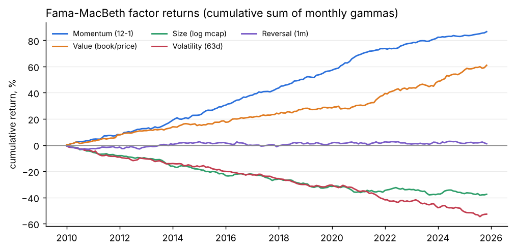
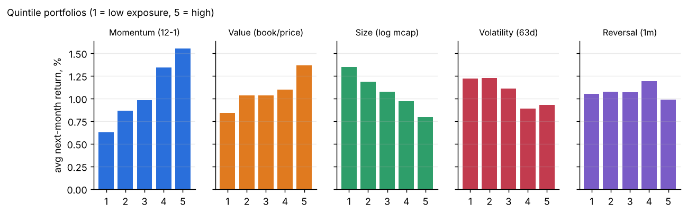
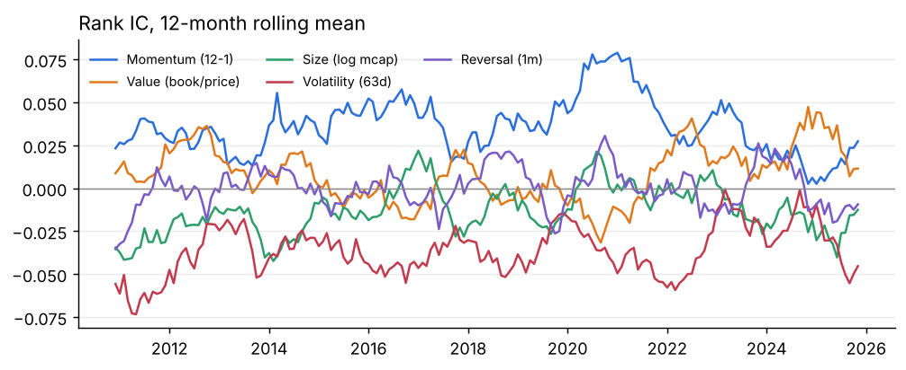

# Equity factor research: Fama-MacBeth report

191 monthly cross-sections, mean R² 0.016, engine: numpy

| Factor | Planted %/mo | Premium %/mo | Annualized % | NW t (L=6) | % months > 0 | Mean IC | ICIR (ann.) | Q5−Q1 %/mo |
|---|---:|---:|---:|---:|---:|---:|---:|---:|
| **Momentum (12-1)** | **+0.400** | **+0.454** | **+5.44** | **+10.55** | **79%** | **+0.0353** | **+2.51** | **+0.926** |
| **Value (book/price)** | **+0.300** | **+0.319** | **+3.83** | **+6.70** | **72%** | **+0.0084** | **+0.57** | **+0.527** |
| **Size (log mcap)** | **-0.200** | **-0.197** | **-2.36** | **-4.14** | **37%** | **-0.0138** | **-0.98** | **-0.552** |
| **Volatility (63d)** | **-0.250** | **-0.276** | **-3.31** | **-7.26** | **32%** | **-0.0366** | **-2.58** | **-0.290** |
| Reversal (1m) | +0.000 | +0.005 | +0.07 | +0.19 | 53% | -0.0016 | -0.11 | -0.067 |

Premium is the time-series mean of the monthly cross-sectional slope on each standardized (winsorized 1/99, z-scored) exposure, so it is the monthly return to one standard deviation of that characteristic, holding the others fixed. Bold rows have |t| > 2 using Newey-West standard errors.

Variance inflation factors: Momentum (12-1) 1.08, Value (book/price) 1.47, Size (log mcap) 1.33, Volatility (63d) 1.18, Reversal (1m) 1.01. Values near 1 mean the exposures are not collinear, so each gamma is cleanly identified.

## Cumulative factor returns

## Quintile portfolios

## Rank IC

